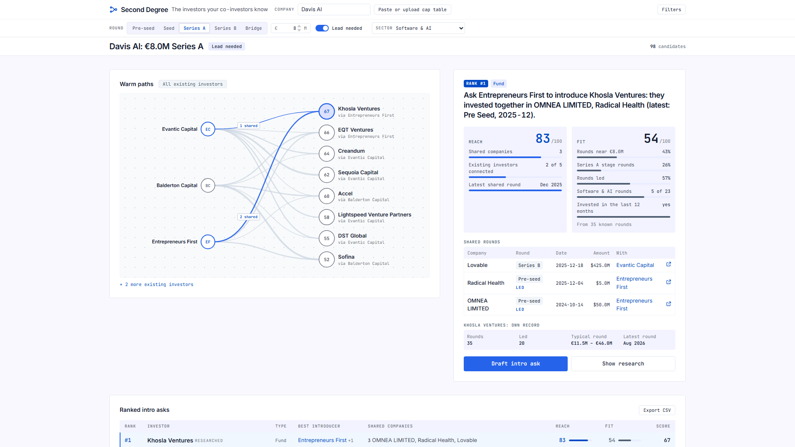

# Second Degree

**The investors your co-investors know.**

Second Degree turns a startup's cap table into a ranked list of warm introduction requests.
For each target investor it shows which existing investor can make the introduction, the rounds they did together and a public source for each round.
Targets are ranked by reach (how warm the path is) and fit (how well their own record matches the round).
Look at the whole cap table, or view it as one existing investor to see who you can contact directly and who only your co-investors know.
Read the cap table from the graph, or paste or upload it (CSV, XLSX or PDF).



## Run locally

```powershell
pip install -r requirements.txt
python app.py
```

Open <http://127.0.0.1:8000>. The app runs from the committed cache and needs no API key.
Optional keys go in `.env` in the repository root (never committed):

- `ANTHROPIC_API_KEY`: Claude reads investor names from pasted or uploaded text in any format. Without it, a rule-based split is used. When hosted, the model is used for at most 40 cap tables a day.
- `CALA_API_KEY`: the "Research" button asks Cala for recent investments of a target. Without it, only cached notes are shown.

## How the graph is built from Cala

The crawl (`crawl/cala_crawl.py`) starts from Nordic seed investors and uses three fast Cala entity operations:

1. **Search** an investor by name, and keep the entities whose name matches (duplicates are merged).
2. **Retrieve** each entity with its `INVESTED_IN` and `PARTICIPATES_IN_FUNDING_ROUND` relationships.
3. **Retrieve** every funding round: date, amount, round label, issuer, and all participants with their lead flag and source links.

A fourth operation, Cala's **knowledge search**, answers the research question for one target, with cited sources.

The committed graph was crawled on 13 and 14 November 2026 with about 1,400 Cala calls:

| | |
|---|---|
| Funding rounds | 557 |
| Investors | 1,498 |
| Companies | 394 |
| Investor labels (type and display name) | 1,175, 347 checked by hand |
| Company sectors | 290 |
| Cached research notes | 16 |

All joins and both scores are computed locally in `xray_core.py`. Serving a plan never calls Cala.

Files in `crawl_cache/`:

- `rounds.json`: the graph used by the app, the union of every crawled round.
- `investor_types.json`: investor type and display name.
- `company_sectors.json`: one sector per company.
- `research.json`: cached research notes.

The per-call Cala responses are kept out of the repository.

### Refresh the graph

With `CALA_API_KEY` in `.env`:

```powershell
python crawl/cala_crawl.py                          # the built-in seeds
python crawl/cala_crawl.py --seeds-file seeds.json  # or a JSON list of investor names
```

A rerun skips calls that are already cached, so it can be stopped and resumed. The running app picks up the new `rounds.json` without a restart. New investors that are not in `investor_types.json` get a type from their name. New companies need a sector in `company_sectors.json` to count in the sector part of fit.

## Sources

The graph is based on publicly announced funding rounds from Cala. Every shared round in an intro path links to its source.
